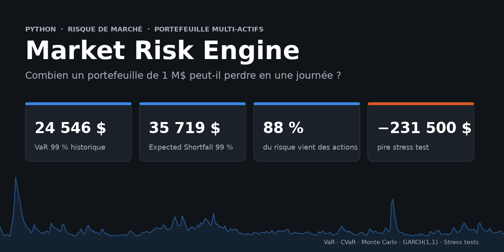
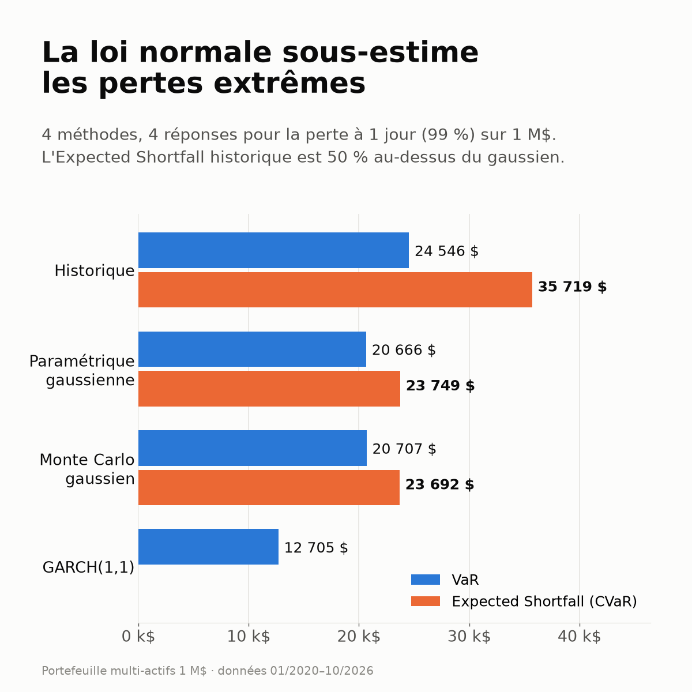
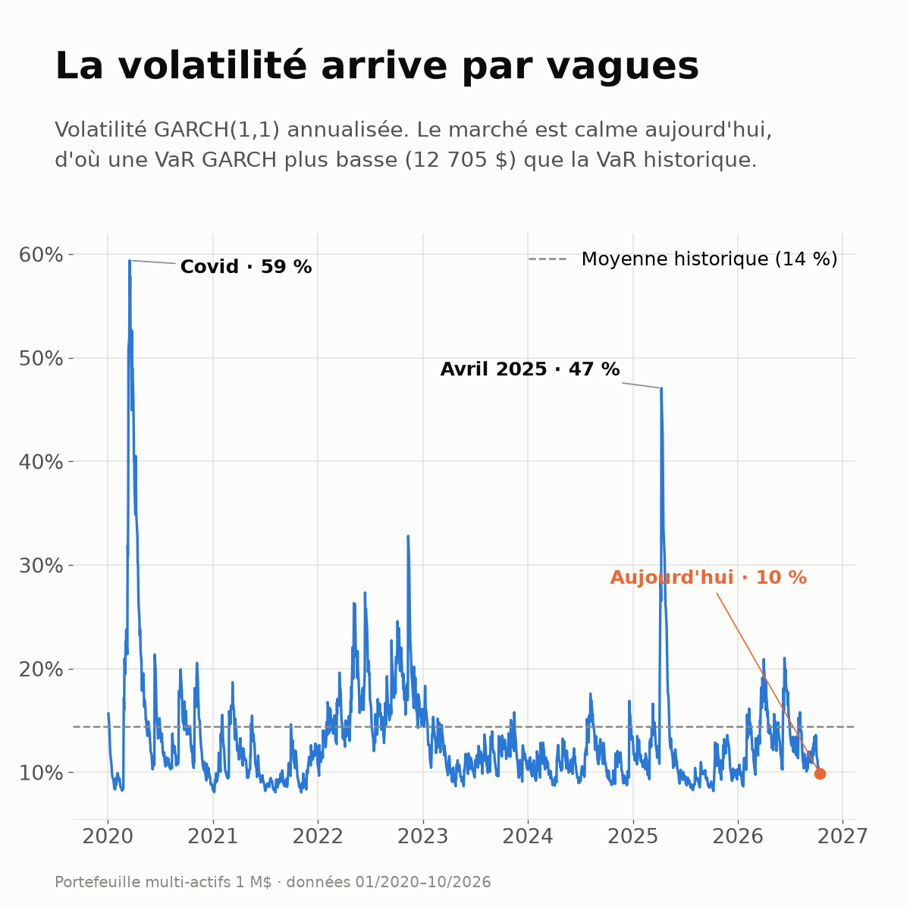
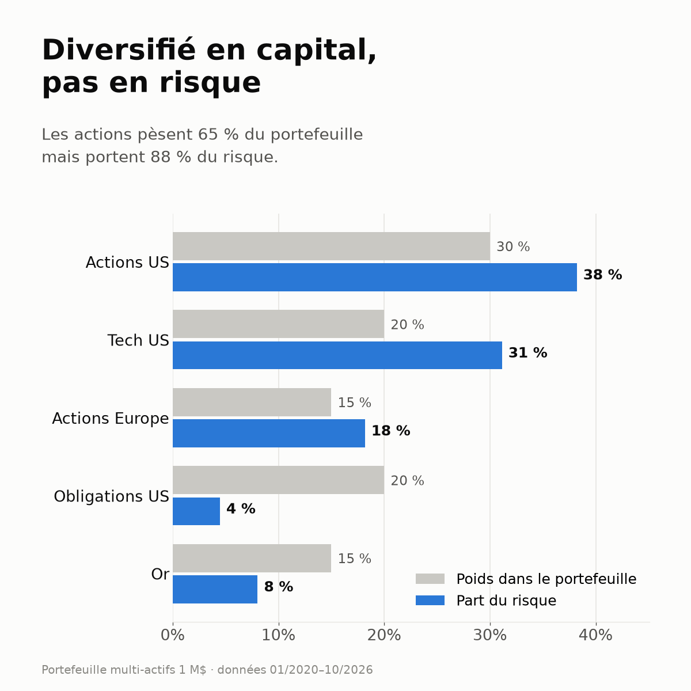
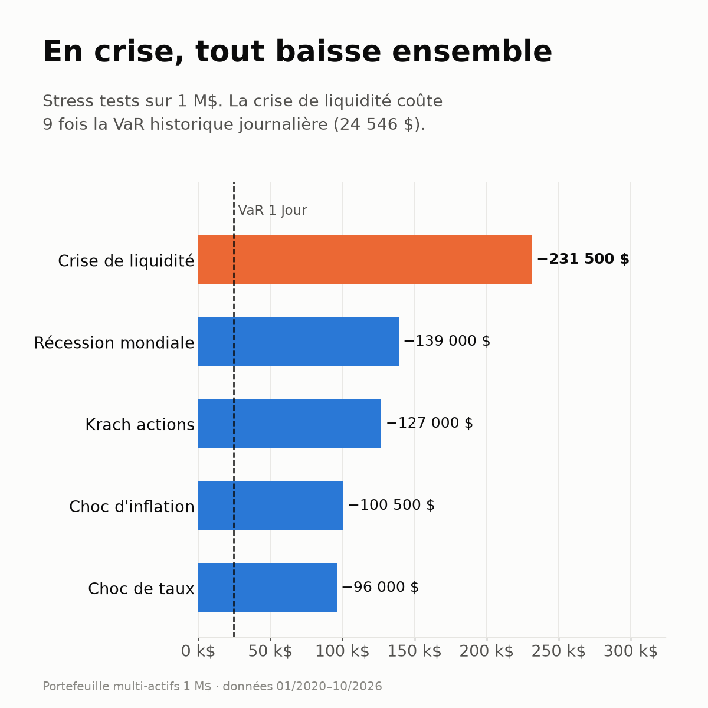
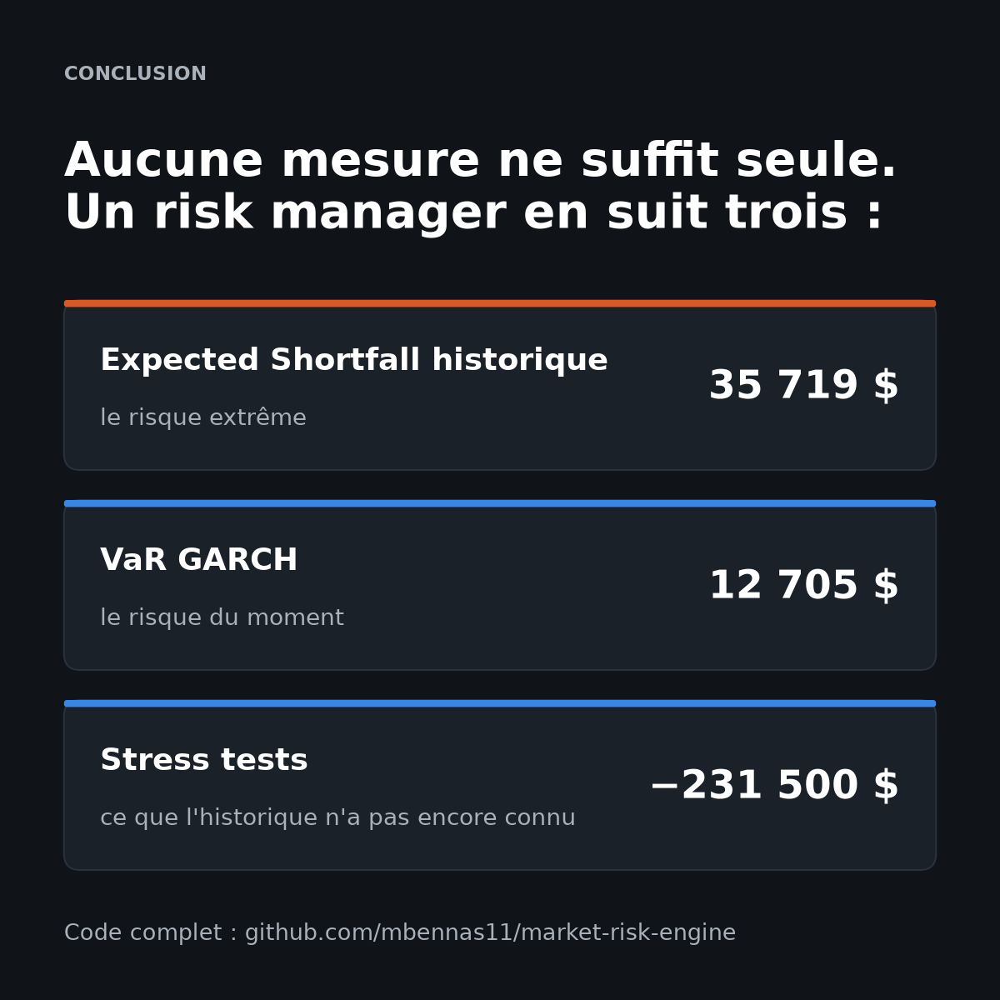

<p align="center">
  
</p>

<p align="center">
  
  
  
  
  
</p>

<h3 align="center">Combien un portefeuille de 1 M$ peut-il perdre en un jour ?<br>4 méthodes de VaR, 4 réponses différentes.</h3>

---

## 🛠️ Le projet

Un moteur de risque de marché en Python, appliqué à un portefeuille de **1 M$** sur 5 ETF, avec des données réelles de janvier 2020 au 13 octobre 2026 (Covid, inflation de 2022, choc d'avril 2025) :

- **VaR et Expected Shortfall (CVaR) à 99 %**, horizon 1 jour : historique, paramétrique gaussienne, Monte Carlo (100 000 scénarios)
- **Volatilité GARCH(1,1)** par actif, pour une VaR dynamique
- **5 stress tests** et **décomposition du risque** par actif

| Actif | ETF | Poids |
|---|---|:---:|
| Actions US | SPY | 30 % |
| Tech US | QQQ | 20 % |
| Actions Europe | VGK | 15 % |
| Treasuries US 20 ans et + | TLT | 20 % |
| Or | GLD | 15 % |

## 📊 Les résultats

**Perte à 1 jour, niveau de confiance 99 %**

| Méthode | VaR | Expected Shortfall (CVaR) |
|---|---:|---:|
| **Historique** | **24 546 $** (2,45 %) | **35 719 $** (3,57 %) |
| Paramétrique gaussienne | 20 666 $ (2,07 %) | 23 749 $ (2,37 %) |
| Monte Carlo gaussien | 20 707 $ (2,07 %) | 23 692 $ (2,37 %) |
| GARCH(1,1) | 12 705 $ (1,27 %) | n/a |

| Indicateur | Résultat |
|---|---|
| 💥 Pire stress test (crise de liquidité) | **−231 500 $** (−23,2 %) |
| 📉 Pire perte réelle (max drawdown) | **−26,5 %** en 2022 |
| ⚖️ Part du risque portée par les actions | **88 %** pour 65 % du capital |

<p align="center">
  
</p>

## ✅ Conclusion

<table>
<tr>
<td width="50%" valign="top">

**1. La loi normale sous-estime le risque extrême.**
L'Expected Shortfall historique est **50 % plus élevé** que l'ES gaussien. Pour mesurer les pertes extrêmes, l'ES historique est la mesure la plus fiable, et c'est le standard de Bâle (FRTB).

</td>
<td width="50%" valign="top">

**2. Un Monte Carlo gaussien n'apporte rien.**
Il redonne la VaR paramétrique (20 707 $ contre 20 666 $) : simuler une loi normale redonne la loi normale. Sa valeur viendra d'une loi à queues épaisses.

</td>
</tr>
<tr>
<td></td>
<td></td>
</tr>
<tr>
<td valign="top">

**3. La VaR GARCH est la plus basse, car le marché est calme.**
Volatilité actuelle de 10 % contre 14 % en moyenne. C'est aussi la plus réactive : elle est montée à 59 % pendant le Covid, alors que la VaR historique réagit avec retard.

</td>
<td valign="top">

**4. La diversification est surtout apparente.**
Les actions pèsent 65 % du capital mais **88 % du risque**. Les obligations : 20 % du capital, 4 % du risque.

</td>
</tr>
<tr>
<td></td>
<td></td>
</tr>
<tr>
<td valign="top">

En crise de liquidité, tout baisse ensemble : **−231 500 $, 9 fois la VaR**. Le pire drawdown réel (−26,5 %) date de **2022**, quand actions et obligations ont chuté en même temps.

</td>
<td valign="top">

👉 **En pratique,** aucune mesure ne suffit seule. Un risk manager suit l'**ES historique** (risque extrême), la **VaR GARCH** (risque du moment) et les **stress tests** (scénarios encore jamais vus).

</td>
</tr>
</table>

## 🧮 Méthodologie

Notations : $r$ est le rendement journalier du portefeuille, $w$ le vecteur des poids, $\Sigma$ la matrice de covariance et $\alpha$ = 1 %.

**VaR et Expected Shortfall historiques** (quantile empirique des rendements observés)

```math
\mathrm{VaR}_{\alpha} = -q_{\alpha}(r) \qquad \mathrm{ES}_{\alpha} = -\mathbb{E}\left[ r \mid r \le q_{\alpha}(r) \right]
```

**Paramétrique gaussienne**

```math
\mathrm{VaR}_{\alpha} = -(\mu + \sigma z_{\alpha}) \qquad \mathrm{ES}_{\alpha} = -\left(\mu - \sigma \frac{\varphi(z_{\alpha})}{\alpha}\right)
```

**Monte Carlo** : 100 000 scénarios sur les 5 actifs, agrégés avec les poids

```math
\mathbf{r}^{(k)} \sim \mathcal{N}(\boldsymbol{\mu}, \Sigma), \qquad r_p^{(k)} = w^{\top} \mathbf{r}^{(k)}
```

**GARCH(1,1)** par actif, puis agrégation avec la matrice de corrélation historique $R$

```math
\sigma_t^2 = \omega + a \, \varepsilon_{t-1}^2 + b \, \sigma_{t-1}^2 \qquad \sigma_p = \sqrt{w^{\top} D R D w}, \quad D = \mathrm{diag}(\hat{\sigma}_{1}, \dots, \hat{\sigma}_{5})
```

**Contribution au risque** (la somme des contributions fait 100 %)

```math
RC_i = \frac{w_i (\Sigma w)_i}{w^{\top} \Sigma w}
```

<details>
<summary><b>Détail des stress tests</b></summary>

| Scénario | Actions US | Tech | Europe | Treasuries | Or | **Portefeuille** |
|---|---:|---:|---:|---:|---:|---:|
| Crise de liquidité | −30 % | −35 % | −32 % | −8 % | −5 % | **−23,2 %** |
| Récession mondiale | −25 % | −30 % | −28 % | +10 % | +12 % | **−13,9 %** |
| Krach actions | −20 % | −28 % | −22 % | +5 % | +8 % | **−12,7 %** |
| Choc d'inflation | −12 % | −18 % | −10 % | −18 % | +15 % | **−10,1 %** |
| Choc de taux | −8 % | −12 % | −7 % | −15 % | −5 % | **−9,6 %** |
</details>

## 🚀 Lancer le projet

```bash
git clone https://github.com/mbennas11/market-risk-engine.git
cd market-risk-engine
pip install -r requirements.txt
python market_risk_engine.py     # rapport de risque complet, sur les données jusqu'à aujourd'hui
python generate_charts.py        # visuels du dossier images/, sur les données jusqu'au 13/10/2026
```

> `market_risk_engine.py` télécharge les données jusqu'au jour d'exécution, donc ses chiffres évoluent. Les résultats de ce README sont figés au 13/10/2026 pour rester reproductibles.

## 🔜 Prochaines étapes

- [ ] **Backtesting** de la VaR : tests de Kupiec et de Christoffersen
- [ ] **Queues épaisses** : GARCH avec loi de Student, Monte Carlo par bootstrap historique
- [ ] **Corrélations dynamiques** : DCC-GARCH
- [ ] **Stress tests historiques** : 2008, mars 2020, 2022

---

<p align="center">
  <b>Mohammed Bennas</b>, étudiant ingénieur en finance (ESILV), à la recherche d'un stage en risque de marché / finance de marché<br>
  <a href="https://www.linkedin.com/in/mohammed-bennas/">LinkedIn</a> · <a href="https://github.com/mbennas11">GitHub</a>
</p>
