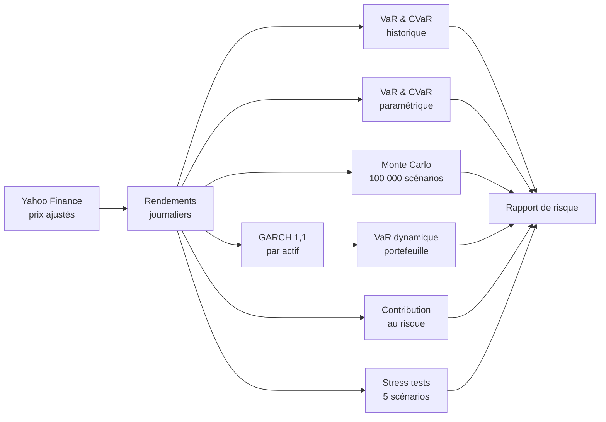

<p align="center">
  
</p>

<p align="center">
  
  
  
  
  
</p>

<p align="center">
  <b>VaR · Expected Shortfall · Monte Carlo · GARCH · Stress tests · Contribution au risque</b><br>
  Un moteur de risque de marché complet, sur données réelles, en un seul script Python.
</p>

---

## 🎯 En 30 secondes

Un portefeuille de **1 M$** réparti sur 5 classes d'actifs est analysé sur près de 7 ans de données de marché (janvier 2020 à octobre 2026, Covid, inflation de 2022 et choc d'avril 2025 inclus).

| | Résultat | Ce que ça veut dire |
|---|---|---|
| 📉 **VaR 99 % à 1 jour** | **24 544 $** (2,45 %) | 1 jour sur 100, la perte dépasse ce montant |
| 🔥 **Expected Shortfall 99 %** | **35 719 $** (3,57 %) | Perte moyenne pendant ces jours-là, 50 % de plus que ce que prévoit la loi normale |
| ⚖️ **Concentration du risque** | **88 %** | Part du risque portée par les actions, qui ne pèsent que 65 % du capital |
| 💥 **Pire stress test** | **−231 500 $** (−23,1 %) | Crise de liquidité, environ 9 fois la VaR journalière |
| 📊 **Max drawdown réel** | **−26,5 %** | 2022 : actions et obligations ont baissé en même temps |

## 💼 Le portefeuille

| Actif | ETF | Poids | Rôle |
|---|---|:---:|---|
| 📈 Actions US | SPY | 30 % | Cœur du portefeuille |
| 💻 Tech US | QQQ | 20 % | Croissance, forte volatilité |
| 🌍 Actions Europe | VGK | 15 % | Diversification géographique |
| 🏛️ Treasuries US 20 ans et + | TLT | 20 % | Couverture en cas de récession |
| 🥇 Or | GLD | 15 % | Valeur refuge, couverture contre l'inflation |

## ⚙️ Pipeline



## 💡 Ce qu'il faut retenir

<table>
<tr>
<td width="50%"></td>
<td width="50%"></td>
</tr>
<tr>
<td valign="top">

**1. La loi normale sous-estime la gravité des pertes.**
La VaR historique dépasse la VaR gaussienne de 19 %, et l'Expected Shortfall de **50 %**. La loi normale se trompe peu sur le seuil, mais beaucoup sur ce qui se passe au-delà. C'est pour cette raison que la réglementation (FRTB, Bâle III) a remplacé la VaR 99 % par l'**Expected Shortfall 97,5 %**.

</td>
<td valign="top">

**2. La volatilité arrive par vagues.**
La volatilité GARCH passe de moins de 10 % à **59 % (Covid)** et **47 % (avril 2025)**. Le marché étant calme aujourd'hui, la VaR GARCH (1,48 %) est *inférieure* à la VaR historique. Une VaR conditionnelle suit le régime de marché, une VaR historique a toujours du retard.

</td>
</tr>
<tr>
<td width="50%"></td>
<td width="50%"></td>
</tr>
<tr>
<td valign="top">

**3. Le poids d'un actif n'est pas son risque.**
Les actions représentent 65 % du capital mais **88 % du risque**. Les obligations : 20 % du capital, 4 % du risque. Diversifier le capital ne veut pas dire diversifier le risque, d'où l'intérêt des approches *risk parity*.

</td>
<td valign="top">

**4. La diversification disparaît en période de crise.**
En crise de liquidité, tout baisse ensemble : **−23 %**. Ce n'est pas que théorique : le pire drawdown réel (−26,5 %) date de **2022**, quand actions et obligations ont chuté en même temps.

</td>
</tr>
</table>

**5. Un Monte Carlo ne vaut que par la distribution qu'il simule.** Le Monte Carlo gaussien donne la même VaR que la méthode paramétrique (2,07 %) : simuler une loi normale redonne la loi normale. Pour qu'il apporte quelque chose, il faut une distribution à queues épaisses (Student, bootstrap historique, copules).

## 📊 Résultats détaillés

<details>
<summary><b>VaR et Expected Shortfall à 99 %, horizon 1 jour</b></summary>

| Méthode | VaR | Expected Shortfall |
|---|---:|---:|
| Historique | 2,45 % · 24 544 $ | **3,57 % · 35 719 $** |
| Paramétrique gaussienne | 2,07 % · 20 675 $ | 2,38 % · 23 759 $ |
| Monte Carlo gaussien | 2,07 % · 20 717 $ | 2,37 % · 23 702 $ |
| GARCH(1,1) | 1,48 % · 14 769 $ | n/a |

Rendement annualisé 12,4 % · volatilité 14,4 % · pire journée −6,9 % (12/03/2020)
</details>

<details>
<summary><b>Stress tests</b></summary>

| Scénario | Actions US | Tech | Europe | Treasuries | Or | **Portefeuille** |
|---|---:|---:|---:|---:|---:|---:|
| Crise de liquidité | −30 % | −35 % | −32 % | −8 % | −5 % | **−23,1 %** |
| Récession mondiale | −25 % | −30 % | −28 % | +10 % | +12 % | **−13,9 %** |
| Krach actions | −20 % | −28 % | −22 % | +5 % | +8 % | **−12,7 %** |
| Choc d'inflation | −12 % | −18 % | −10 % | −18 % | +15 % | **−10,1 %** |
| Choc de taux | −8 % | −12 % | −7 % | −15 % | −5 % | **−9,6 %** |
</details>

## 🧮 Méthodologie

Notations : $r$ est le rendement journalier du portefeuille, $w$ le vecteur des poids, $\Sigma$ la matrice de covariance et $\alpha$ = 1 %.

**VaR et Expected Shortfall historiques** (quantile empirique des rendements observés)

```math
\mathrm{VaR}_{\alpha} = -q_{\alpha}(r) \qquad \mathrm{ES}_{\alpha} = -\mathbb{E}\left[ r \mid r \le q_{\alpha}(r) \right]
```

**Paramétrique gaussienne**

```math
\mathrm{VaR}_{\alpha} = -(\mu + \sigma z_{\alpha}) \qquad \mathrm{ES}_{\alpha} = -\left(\mu - \sigma \frac{\varphi(z_{\alpha})}{\alpha}\right)
```

**Monte Carlo** : 100 000 scénarios sur les 5 actifs, agrégés avec les poids

```math
\mathbf{r}^{(k)} \sim \mathcal{N}(\boldsymbol{\mu}, \Sigma), \qquad r_p^{(k)} = w^{\top} \mathbf{r}^{(k)}
```

**GARCH(1,1)** par actif, puis agrégation avec la matrice de corrélation historique $R$

```math
\sigma_t^2 = \omega + a \, \varepsilon_{t-1}^2 + b \, \sigma_{t-1}^2 \qquad \sigma_p = \sqrt{w^{\top} D R D w}, \quad D = \mathrm{diag}(\hat{\sigma}_{1}, \dots, \hat{\sigma}_{5})
```

**Contribution au risque** (la somme des contributions fait 100 %)

```math
RC_i = \frac{w_i (\Sigma w)_i}{w^{\top} \Sigma w}
```


## 🚀 Lancer le projet

```bash
git clone https://github.com/mbennas11/market-risk-engine.git
cd market-risk-engine
pip install -r requirements.txt
python market_risk_engine.py     # rapport de risque complet et graphiques
python generate_charts.py        # régénère les visuels du dossier images/
```

> Les données vont jusqu'au jour d'exécution, donc les chiffres évoluent à chaque lancement.

```
market-risk-engine/
├── market_risk_engine.py   # moteur de risque (VaR, ES, Monte Carlo, GARCH, stress tests)
├── generate_charts.py      # visuels du README
├── requirements.txt
└── images/
```

## 🛣️ Prochaines étapes

- [ ] **Backtesting** de la VaR : tests de Kupiec et de Christoffersen
- [ ] **Queues épaisses** : GARCH avec loi de Student, Monte Carlo par bootstrap historique
- [ ] **Corrélations dynamiques** : DCC-GARCH
- [ ] **Stress tests historiques** : 2008, mars 2020, 2022
- [ ] VaR à 10 jours et Expected Shortfall 97,5 % (standard FRTB)

---

<p align="center">
  <b>Mohammed Bennas</b>, étudiant ingénieur en finance (ESILV), à la recherche d'un stage en risque de marché / finance de marché<br>
  <a href="https://www.linkedin.com/in/mohammed-bennas/">LinkedIn</a> · <a href="https://github.com/mbennas11">GitHub</a>
</p>
