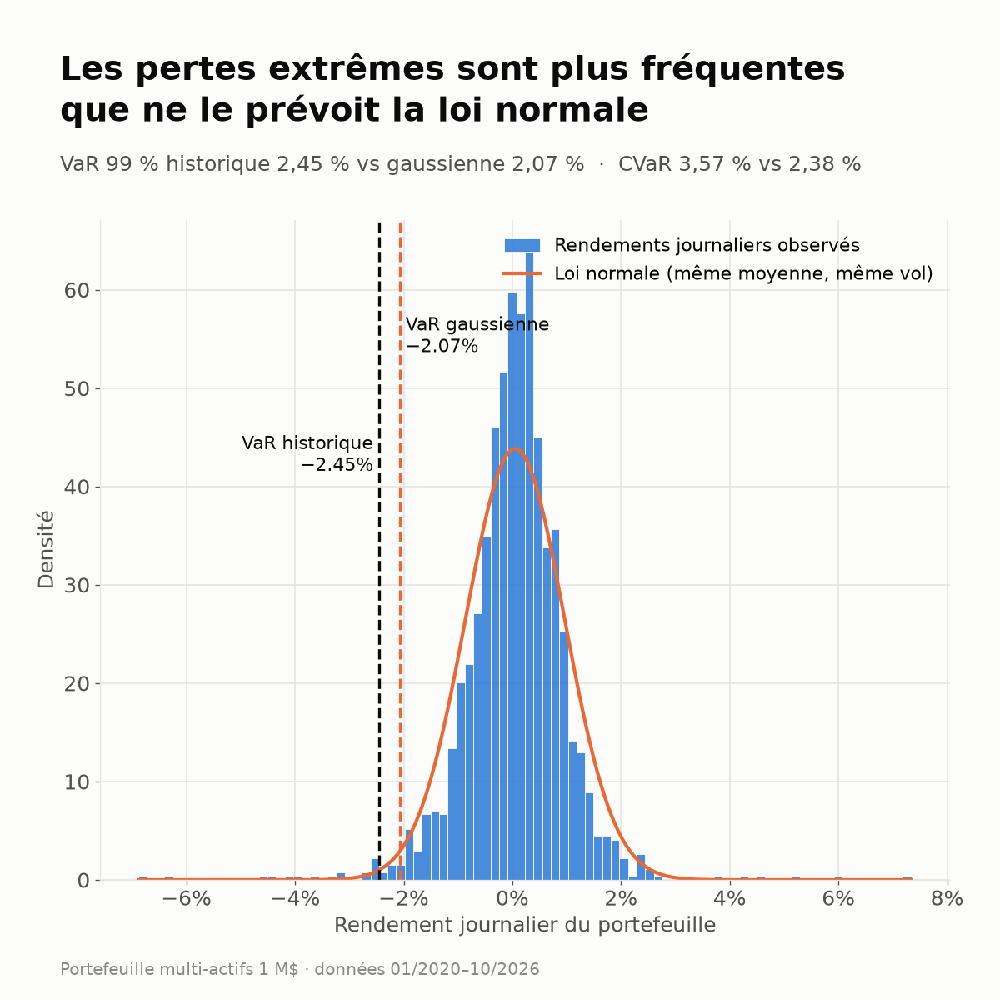
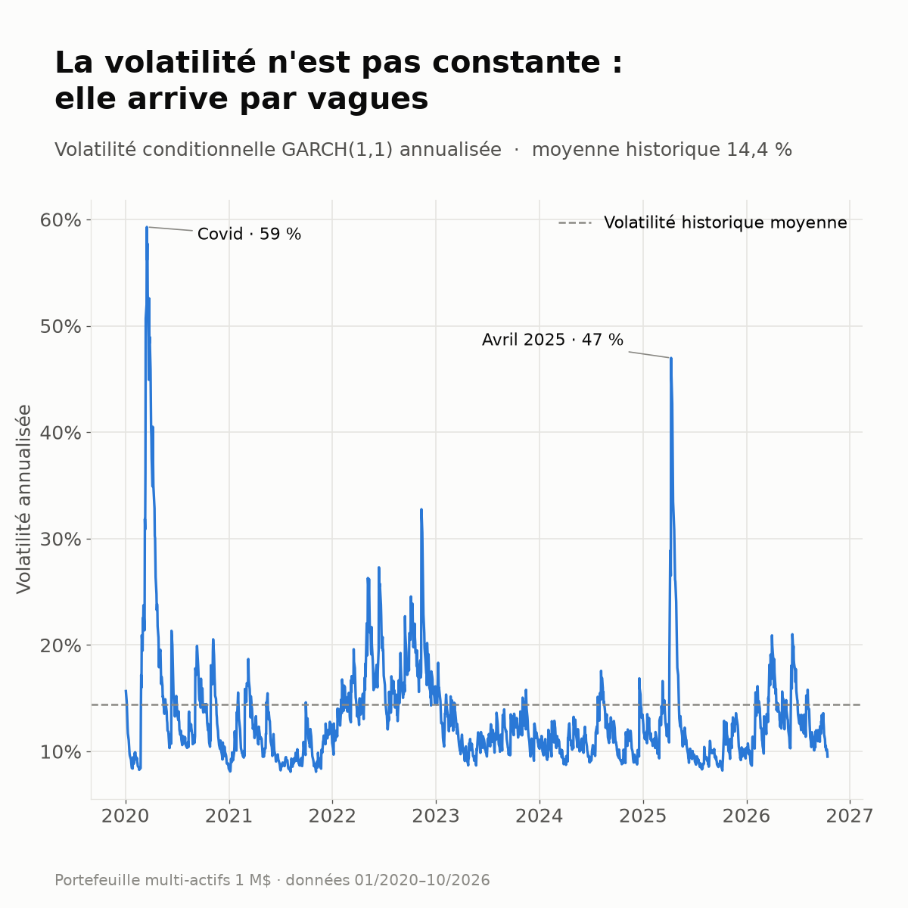
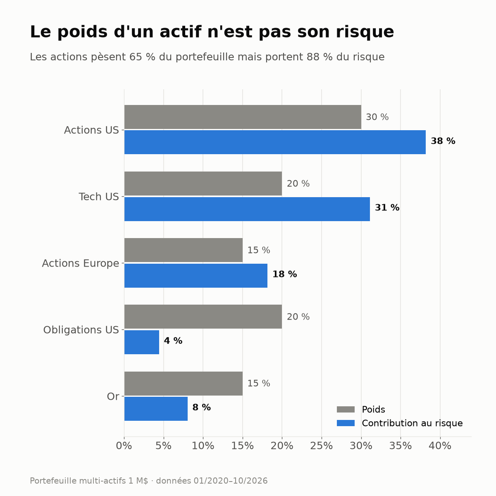
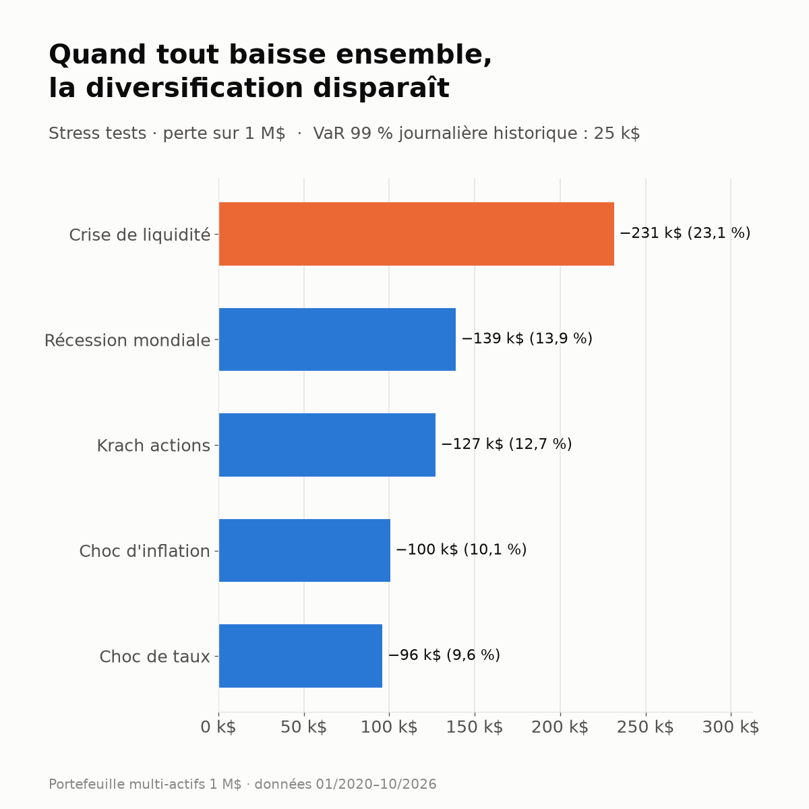

# Market Risk Engine : portefeuille multi-actifs

Moteur de mesure du risque de marché en Python pour un portefeuille de **1 M$** réparti sur 5 classes d'actifs, à partir de données de marché réelles (Yahoo Finance, depuis janvier 2020).

**Question posée :** combien ce portefeuille peut-il perdre en une journée, en cas de crise, et d'où vient ce risque ?

| Actif | Ticker | Poids |
|---|---|---|
| Actions US | SPY | 30 % |
| Tech US | QQQ | 20 % |
| Actions Europe | VGK | 15 % |
| Obligations du Trésor US (20 ans et +) | TLT | 20 % |
| Or | GLD | 15 % |

## Méthodes

| Module | Ce qu'il mesure |
|---|---|
| **VaR historique** | Le 1 % des pires rendements réellement observés, sans hypothèse de distribution |
| **VaR paramétrique** | La même mesure en supposant des rendements gaussiens (moyenne / écart-type) |
| **VaR Monte Carlo** | 100 000 scénarios tirés d'une loi normale multivariée (matrice de covariance des 5 actifs) |
| **CVaR / Expected Shortfall** | La perte moyenne **au-delà** de la VaR, autrement dit l'ampleur des pertes dans le pire 1 % des cas |
| **GARCH(1,1)** | La volatilité de demain estimée à partir des chocs récents, agrégée au niveau du portefeuille pour une VaR dynamique |
| **Stress tests** | 5 scénarios extrêmes hypothétiques appliqués actif par actif |
| **Contribution au risque** | La part de la volatilité totale du portefeuille apportée par chaque actif |
| **Maximum drawdown** | La pire baisse entre un plus haut et un plus bas |

## Résultats (données du 02/01/2020 au 14/10/2026)

**Risque à 1 jour, niveau de confiance 99 %**

| Méthode | VaR | CVaR |
|---|---|---|
| Historique | 2,45 % (24 544 $) | **3,57 % (35 719 $)** |
| Paramétrique gaussienne | 2,07 % (20 675 $) | 2,38 % (23 759 $) |
| Monte Carlo (gaussien) | 2,07 % (20 717 $) | 2,37 % (23 702 $) |
| GARCH(1,1) | 1,48 % (14 769 $) | n/a |

Rendement annualisé 12,4 % · volatilité 14,4 % · pire journée −6,9 % (12/03/2020) · **max drawdown −26,5 % (déc. 2021 → oct. 2022)**

**Stress tests**

| Scénario | Perte |
|---|---|
| Crise de liquidité | **−23,1 % (−231 500 $)** |
| Récession mondiale | −13,9 % |
| Krach actions | −12,7 % |
| Choc d'inflation | −10,1 % |
| Choc de taux | −9,6 % |

## Ce qu'il faut retenir

### 1. La loi normale sous-estime surtout la gravité des pertes


La VaR historique dépasse la VaR gaussienne de 19 %, mais l'écart est surtout sur la **CVaR : +50 %** (3,57 % contre 2,38 %). La loi normale se trompe peu sur le seuil de perte, mais beaucoup sur **ce qui se passe une fois ce seuil franchi**. C'est la raison pour laquelle la réglementation bancaire (FRTB, Bâle III) a remplacé la VaR 99 % par l'**Expected Shortfall à 97,5 %** pour le calcul des fonds propres de marché.

### 2. Un Monte Carlo ne vaut que par la distribution qu'il simule
Le Monte Carlo donne quasiment le même résultat que la méthode paramétrique (2,07 % contre 2,07 %). C'est normal : simuler une loi normale redonne la loi normale. L'intérêt du Monte Carlo vient de ce qu'on y met : loi de Student, rééchantillonnage historique, copules, produits non linéaires comme les options. C'est la principale amélioration à faire.

### 3. La volatilité arrive par vagues


La volatilité conditionnelle du GARCH passe de moins de 10 % à **59 % (Covid)** et **47 % (avril 2025)**. Une volatilité moyenne de 14,4 % ne décrit jamais vraiment le marché. Aujourd'hui, le marché est calme et la VaR GARCH (1,48 %) est donc **inférieure** à la VaR historique. En période de crise, ce serait l'inverse. Une VaR conditionnelle réagit au régime de marché, une VaR historique a du retard.

### 4. Le poids d'un actif n'est pas son risque


Les actions représentent **65 % du capital mais 88 % du risque**. Les obligations, avec 20 % du capital, n'apportent que 4 % du risque. Ce portefeuille est donc en réalité un portefeuille actions. Diversifier le capital ne veut pas dire diversifier le risque : c'est l'idée de base des approches *risk parity*.

### 5. La diversification disparaît quand on en a le plus besoin


Dans le scénario de crise de liquidité, toutes les classes d'actifs baissent ensemble et la perte atteint **23 %, soit environ 9 fois la VaR journalière**. Ce n'est pas qu'un scénario théorique : le **max drawdown réel (−26,5 %) date de 2022**, quand l'inflation a fait baisser en même temps les actions et les obligations. Les corrélations historiques utilisées par la VaR ne tiennent plus pendant une crise.

## Limites et pistes d'amélioration
- **Backtesting** de la VaR (test de Kupiec, test de Christoffersen) pour vérifier que le nombre de dépassements correspond bien à 1 %
- **Lois à queues épaisses** : GARCH avec une loi de Student, Monte Carlo par bootstrap historique
- **Corrélations dynamiques** (DCC-GARCH) au lieu d'une matrice de corrélation fixe
- **Stress tests historiques** (2008, mars 2020, 2022) en plus des scénarios hypothétiques
- Horizon de 10 jours et poids du portefeuille qui évoluent dans le temps

## Lancer le projet
```bash
pip install -r requirements.txt
python market_risk_engine.py     # rapport de risque complet + graphiques
python generate_charts.py        # régénère les visuels du dossier images/
```
Les résultats changent selon la date d'exécution, car les données vont jusqu'au jour courant.

**Stack :** Python · NumPy · pandas · SciPy · arch · yfinance · Matplotlib

---
*Mohammed Bennas, étudiant ingénieur à la recherche d'un stage en risque de marché / finance de marché.*
